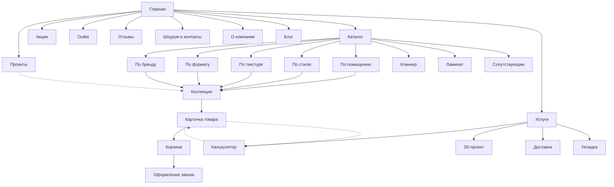

# Kiva — карта сайта

**Контекст.** Kiva — салон керамической плитки в Минске (пр-т Дзержинского, 131). По данным Яндекс.Карт, в ассортименте настенная плитка, керамогранит, клинкер и ламинат.
**Цель нового сайта:** продажи онлайн и запись в шоурум. Посетитель выбирает плитку от задачи («плитка для ванной»), а не от артикула.
**Ориентиры конкурентов:** навигация по применению — tileberry.by; цены, корзина и покупка в 1 клик — atrium.by; калькулятор и 3D-проект — dtls.by.

## Дерево страниц

```
Главная  /
├── Каталог  /catalog
│   ├── По помещению  /catalog/room/{bathroom|kitchen|floor|hallway|facade|terrace|pool}
│   ├── По стилю  /catalog/style/{scandi|loft|classic|modern|eco}
│   ├── По текстуре  /catalog/texture/{marble|wood|concrete|stone|mono|pattern}
│   ├── По формату  /catalog/format/{small|60x60|60x120|large-slab|mosaic}
│   ├── По бренду  /catalog/brand/{brand}
│   ├── Коллекция  /collection/{slug}
│   │   └── Карточка товара  /product/{slug}
│   ├── Клинкер  /catalog/clinker
│   ├── Ламинат  /catalog/laminate
│   └── Сопутствующие (клей, затирка, профили)  /catalog/accessories
├── Акции  /sale
├── Outlet (остатки партий)  /outlet
├── Услуги  /services
│   ├── Калькулятор плитки  /services/calculator
│   ├── Бесплатный 3D-проект  /services/3d-project
│   ├── Доставка и подъём  /services/delivery
│   └── Укладка (партнёры)  /services/installation
├── Проекты (интерьеры клиентов)  /projects
│   └── Проект  /projects/{slug}
├── Отзывы  /reviews
├── Шоурум и контакты  /showroom
├── О компании  /about
├── Блог / советы по выбору  /blog
│   └── Статья  /blog/{slug}
└── Служебные
    ├── Поиск  /search
    ├── Избранное  /favorites
    ├── Корзина  /cart
    ├── Оформление заказа  /checkout
    ├── Доставка и оплата  /delivery-payment
    ├── Возврат  /returns
    ├── FAQ  /faq
    └── Политика обработки персональных данных  /privacy
```

## Схема (Mermaid)



## Страницы: цель и главный CTA

| Страница | Цель пользователя | Цель бизнеса | Главный CTA |
|---|---|---|---|
| Главная | Понять, есть ли подходящее, и куда идти | Направить в каталог по задаче, собрать лиды | «Выбрать по помещению», «Получить 3D-проект» |
| Каталог (фильтры) | Сузить выбор | Показать ассортимент и цены | Фильтры, «В корзину» |
| Коллекция | Увидеть плитку в интерьере, подобрать комбинацию | Продать комплект (стена + пол + декор) | «Рассчитать комплект» |
| Карточка товара | Цена, наличие, сколько нужно | Конверсия в заказ | «В корзину», «Купить в 1 клик», «Рассчитать количество» |
| Акции / Outlet | Купить дешевле | Распродать остатки | «В корзину» |
| Калькулятор | Узнать нужное количество в м² и коробках | Перевести в корзину | «Добавить в корзину» |
| 3D-проект | Увидеть ванную до покупки | Тёплый лид, крупный чек | «Оставить заявку» |
| Проекты | Найти вдохновение | Доверие, переход в коллекции | «Смотреть коллекцию из проекта» |
| Отзывы | Убедиться в надёжности | Доверие | «Оставить отзыв» |
| Шоурум | Как доехать, когда открыто | Визит в салон | «Записаться на визит», «Построить маршрут» |
| Корзина / Оформление | Быстро оформить | Минимум отказов | «Оформить заказ» |

## Глобальные элементы

- **Шапка:** логотип, каталог (мегаменю: помещение / стиль / текстура / формат / бренд), поиск, телефон, мессенджеры (Viber, Telegram), избранное, корзина.
- **Мегаменю каталога:** четыре колонки входов в каталог и баннер текущей акции.
- **Липкая панель на мобильном:** «Каталог», «Позвонить», «Корзина».
- **Подвал:** разделы, контакты, график шоурума, способы оплаты (карта, рассрочка — уточнить), реквизиты, политика ПД.

## Фильтры каталога (атрибуты товара)

| Атрибут | Значения (пример) | Тип фильтра |
|---|---|---|
| Помещение | ванная, кухня, пол, прихожая, фасад, терраса, бассейн | мультивыбор |
| Стиль | сканди, лофт, классика, модерн, эко | мультивыбор |
| Текстура | мрамор, дерево, бетон, камень, моноколор, узор | мультивыбор, плитки с превью |
| Цвет | белый, бежевый, серый, графит, тёплый, цветной | цветные свотчи |
| Формат, см | 20×20 … 120×280 | мультивыбор |
| Поверхность | матовая, глянцевая, лаппатированная, структурная | мультивыбор |
| Назначение | стена / пол / универсальная | мультивыбор |
| Страна / бренд | — | мультивыбор с поиском |
| Цена, BYN/м² | диапазон | слайдер |
| Наличие | в салоне / под заказ (срок) | переключатель |

## Открытые вопросы к заказчику

- [ ] Есть ли учётная система с остатками и ценами для интеграции (1С, МойСклад)?
- [ ] Продаём онлайн с оплатой или только «заказ → звонок менеджера»?
- [ ] Делаете 3D-проекты сами или через партнёров? Сроки?
- [ ] Ламинат — постоянное направление или сопутствующее?
- [ ] Рассрочка и карты рассрочки («Халва», «Карта покупок»)?
- [ ] Укладка — свои мастера или партнёры?
